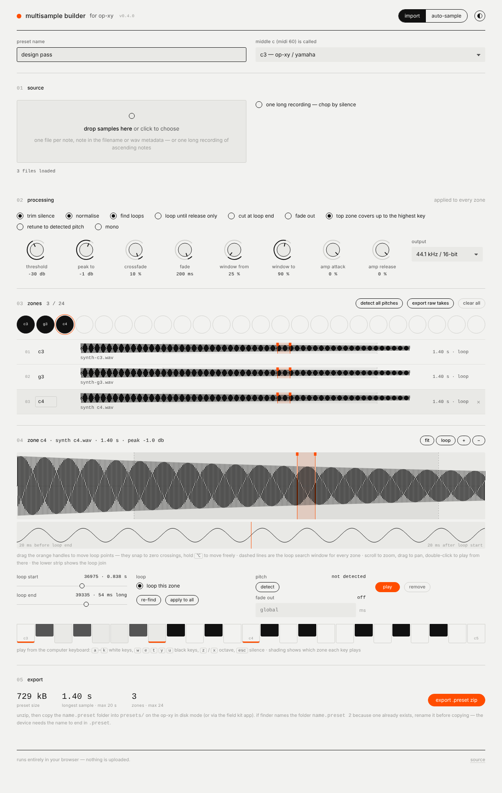

# multisample builder for OP-XY

**Turn any synth into an OP-XY multisampler preset in a couple of minutes.** Plug the synth into
your Mac, press one button, and the tool plays every note over MIDI, records it, trims it, finds
loop points, normalises it, and writes a finished `.preset` folder you drop straight onto the
device. Or hand it a folder of samples and it does the same job without the sampling. Free, open
source, runs entirely in your browser — nothing is uploaded anywhere.

**Use it here:** https://glassides.github.io/opxy-multisample/



Built for the OP-XY on firmware 1.2.0; the `patch.json` it writes is cloned from a preset the
device itself saved, and every build is checked on hardware.

Two ways in, one processing pipeline out:

- **import** — drop a folder of one-note-per-file WAV/AIFF samples (note in the filename or in
  the WAV `smpl` chunk), or one long recording of ascending notes to chop by silence.
- **auto-sample** — play a connected synth over Web MIDI, record it through your audio
  interface, and build the preset automatically, Tonverk-style.

The output is a zip containing `name.preset/patch.json` plus the WAVs, ready to drop into the
OP-XY's `presets/` folder.

## Requirements

- **Chrome or Edge** on the desktop. Web MIDI (needed for auto-sampling) is not available in
  Safari or Firefox; the import mode will mostly work there but is untested.
- For auto-sampling: a MIDI connection to the synth (USB or a MIDI interface) and the synth's
  audio coming into an input on your interface.

## Setup

There is nothing to install. Open the live link above, or clone the repo and open `index.html`
through any static server (ES modules will not load from `file://`):

```
python3 -m http.server 8000
# then open http://localhost:8000
```

### Permissions

- **Microphone / audio input** — Chrome asks the first time you start auto-sampling. Choose your
  audio interface, not the built-in mic. If you dismiss the prompt, click the camera/mic icon in
  the address bar to re-enable it.
- **MIDI** — Chrome asks separately for MIDI access (and for SysEx, which this tool does not use).
- On macOS, Chrome itself must be allowed to use the microphone in
  *System Settings → Privacy & Security → Microphone*.

## Auto-sampling

1. Connect the synth: MIDI from the computer to the synth (USB or a MIDI interface), and the
   synth's audio into an input pair on your interface. Turn off any processing on that input.
2. Press **connect midi & audio**, grant both permissions, pick the MIDI output / channel and the
   audio input / channels. The meter should move when the synth plays.
3. **Play test note** — the tool measures latency and the release tail, and reports noise floor and
   peak. Aim for peaks around −6 to −12 dBFS. Override the numbers if you prefer.
4. Set the **range**: start, end, step in semitones (1 = every note, 12 = one per octave), hold
   time, velocity. The planner shows the zone count and refuses more than 24.
5. **Start sampling**. Each note appears in the zone list as it lands; abort at any time.
6. Review, then **export**.

## Reviewing and editing loops

- Click a zone (list or zone map) to load it into the editor. Scroll to zoom, drag to pan, or use
  **fit** / **loop** / **+** / **−**.
- Drag the orange handles to move the loop points. They snap to rising zero crossings; hold **⌥**
  to move freely. The splice view underneath shows the audio just before the loop end butted
  against the audio just after the loop start — a smooth line means a clean loop.
- The dashed lines are the **loop search window**, where the automatic finder looks. Drag them to
  change the window for every zone (for auto-sampled zones it is measured against the held part of
  the note). **Apply to all** copies the selected zone's loop position to every other zone,
  proportionally, snapped to zero crossings.
- **Detect** reads the pitch of a zone (or **detect all pitches** in the zones header). If it
  disagrees with the root note, **use as root** fixes the key centre. Tick **retune zones to
  detected pitch** in processing to correct small tuning offsets in the audio itself.
- Play from the computer keyboard; the key shading shows which zone each note uses.
- Your zones are kept in the browser between visits; you'll be offered a restore after a reload.
  **Export raw takes** saves the untouched recordings if you want them for another sampler.

## Using the preset on the device

1. Unzip the download. You get a folder called `name.preset`. If Finder has named it
   `name.preset 2` because one already existed, rename it — the device needs the name to end in
   `.preset`.
2. Put the OP-XY in disk mode (or use the field kit app) and copy the whole folder into `presets/`
   (or a subfolder of it).
3. Eject. The preset appears in the sampler's preset list.

Filenames may contain only `a-z A-Z 0-9 space # - ( )` plus the dot for the extension; the tool
sanitises names to match.

## Limits (from the device)

- Max **24 zones** per multisampler.
- Max **20 seconds** per sample.
- WAV or AIFF, mono or stereo. The device itself writes 44.1 kHz / 16-bit / stereo; that is the
  default here, with 22.05 kHz and 11.025 kHz and a mono option to save space.
- Zones fill down: every region has `lokey 0` and the device plays a note from the region with
  the lowest `hikey` that is ≥ the note.

## Note naming

The OP-XY calls MIDI 60 **c3** (so `piano-c3.wav` is middle C). Most DAWs call it C4. The
convention is switchable in the UI; the root note is also written into each WAV's `smpl` chunk,
which the device reads in preference to the name.

## Project layout

```
index.html        the app shell
css/style.css
js/app.js         UI and state
js/notes.js       note name parsing / formatting
js/audio.js       decode, resample, WAV writer (with smpl chunk)
js/process.js     trim, loop search, normalise, cap, fade
js/pitch.js       fallback pitch detection
js/chop.js        silence chopper for long recordings
js/patch.js       patch.json builder (schema from a device-written preset)
js/zip.js         store-only zip writer
js/knob.js        round dial control for range inputs
js/player.js      audition playback
js/loopeditor.js  zoom / pan / drag loop editor with splice view
js/session.js     IndexedDB session persistence
js/midi.js        Web MIDI output
js/recorder.js    continuous audio input capture (+ recorder-worklet.js)
js/sampler.js     auto-sampler: test note, range planning, the run
js/autosample.js  auto-sample mode UI
reference/        patch.json from the device, Tonverk auto-sampler notes
```

No build step: edit, push to `main`, GitHub Pages serves it.

## Licence and credit

MIT — use it, fork it, improve it. If you build on it, a link back is appreciated.

This is an independent tool by Glasside. It is not affiliated
with or endorsed by Teenage Engineering; OP-XY is their trademark. The auto-sampler's workflow
is modelled on the Auto Sampler in the Elektron Tonverk.
